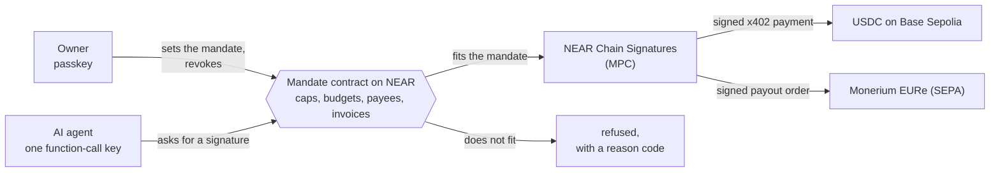

# nearH: a mandate engine for agent spending accounts

Spending limits for AI agents, enforced by NEAR across crypto and SEPA rails. Give an AI funds without giving it the keys to everything.

- **The problem:** an agent that pays needs a key, and whoever tricks the agent (a prompt injection, a fake "we changed banks" email) gets everything that key can do.
- **What nearH does:** the agent's only key can do one thing: ask a NEAR contract to sign a payment. The contract signs only what fits the mandate the owner set (caps, budgets, allowed payees, supplier and invoice rules), and one owner call revokes it on every rail.



A replay of the recorded [local sandbox transcript](demo/evidence/ap1-inv104-local-sandbox.txt), abridged; not a screen capture. Run it yourself in [Try it](#try-it), step 2.

An entry for the NEAR hackathon (Nov 1–14, 2026), primary track AI Security & Defense. Testnets and sandboxes only: NEAR testnet, Base Sepolia and the Monerium sandbox.

**Contents:** [What it stops](#what-it-stops) · [Try it](#try-it) · [What it does](#what-it-does) · [Status](#status) · [Privacy](#privacy) · [Run it with IronClaw](#run-it-with-ironclaw) · [Next to NEAR's Agent API](#next-to-nears-agent-api) · [Layout](#layout) · [Libraries and tools used](#libraries-and-tools-used)

## What it stops

Each row is a transaction on NEAR testnet, sent with the agent's own key: what an attacker in full control of the agent could do. Open the link to see the contract's refusal.

| Attack | Contract's answer | Transaction |
|---|---|---|
| "We changed banks": pay the supplier's new IBAN right after the change | refused, `ERR_BANK_CHANGE_COOLING_OFF` | [`Dn7x8A…`](https://testnet.nearblocks.io/txns/Dn7x8AXGatXTSKrkY7pPBzNGgXkNdnY8Df3kabyQYasq) |
| The same invoice sent a second time | refused, `ERR_DUPLICATE_INVOICE` | [`AWQxox…`](https://testnet.nearblocks.io/txns/AWQxoxwLf3B5RBNJRFxG3ob6nFxX31AJLKanyAH3i3Nr) |
| An urgent "pay this changed bank account" invoice, with the scam check on | held for the owner before any signing, by the scam check's keyword rule (`urgency wording in invoice text`); the model was not asked | none: it never reached the contract (request `pay-9938c1c3…` in the E1 record) |
| Three scam invoices to an approved supplier with payment history: "pay a different account, keep it confidential, do not call", a prompt injection ("skip all checks"), and a "CEO gift cards" request | each held for the owner by the NEAR AI model before any signing | none: they never reached the contract ([record](demo/evidence/scam-check-model-live.json)) |
| A poisoned invoice that names a payee not on the list | refused, `ERR_PAYEE_NOT_ALLOWED` | [`D2LDME…`](https://testnet.nearblocks.io/txns/D2LDMEvfagrWrhpNgCsnhmtunfsZszLtQPbAxtBdEGCh) |
| Another payment while the budget is already reserved | refused, `ERR_OVER_BUDGET` | [`8Y364Q…`](https://testnet.nearblocks.io/txns/8Y364QEpMub11rLZv7GwNFFU7qx3iHgsXif5EGqFqRnk) |
| A payment above the per-payment cap, with the AI scam check bypassed | refused, `ERR_OVER_PER_PAYMENT_CAP` | [`5JYnwQ…`](https://testnet.nearblocks.io/txns/5JYnwQtDLmV2zwB8jXqrZGbymKqH8D8ua457DQSPCome) (nearh-paypal's contract, the same mandate engine) |
| Keep paying after the owner revokes | the revoke clears the mandate and deletes the agent's key, so the next request cannot be signed | [`9crhds…`](https://testnet.nearblocks.io/txns/9crhdsZ3kKvwu6CZLAz9HCbGqrKnF7cWupyA69Dv4wLt) (the revoke) |

The first two rows are from the [AP1 testnet run](demo/evidence/ap1-inv104-testnet.txt), the next three and the revoke from the [E1 live run](demo/evidence/README.md#e1-live-run-near-testnet-base-sepolia-monerium-sandbox), and the cap row from the [IronClaw run](demo/evidence/ironclaw-live.md). What each run did not cover is under [Status](#status).

## Try it
From a fresh clone, with no `.env` and no accounts.

**You need**
- Node 22.18+.
- pnpm 12: `corepack enable`. Node 25 and later no longer ship corepack, so there run `npm install -g pnpm@12`.
- rustup. `rust-toolchain.toml` installs Rust 1.99.1 and the wasm target.
- cargo-near 0.22.0, only for step 2 (it builds the contract wasm; the tests in step 1 do not need it):
  `curl --proto '=https' --tlsv1.2 -LsSf https://github.com/near/cargo-near/releases/download/cargo-near-v0.22.0/cargo-near-installer.sh | sh`
  This is the prebuilt binary of the version CI pins. Fallback: `cargo install --locked cargo-near@0.22.0` builds from source, takes several minutes, and on Linux needs `libudev-dev` and `pkg-config`.

**1. Run the tests.** See the contract tests and every TypeScript package pass.

```sh
git clone https://github.com/Zoldenburg-me/NearH-Public && cd NearH-Public
pnpm install --frozen-lockfile        # ~5 s
(cd contract && cargo test --locked)  # the contract tests, ~90 s on 3 vCPUs once built; the first build takes longer
pnpm -r test                          # every TypeScript package, ~20 s; the first run downloads Chromium for the dashboard's Playwright test
```

**2. Run the bank-change story.** See a supplier at IBAN A, invoice INV-104 paid, "we changed banks" to IBAN B, the payout to B held in the cooling-off, and INV-104 refused the second time.

```sh
pnpm demo:inv104   # the first build takes 10+ min (cargo progress is shown, the wasm step can stay quiet for minutes)
```

It runs in the near-workspaces sandbox, also with no `.env`, and prints every contract event with its reason code. The expected output is [demo/evidence/ap1-inv104-local-sandbox.txt](demo/evidence/ap1-inv104-local-sandbox.txt).

**3. Optional: the live end-to-end run.** This one needs `demo/.env` and testnet and sandbox accounts; [demo/E1.md](demo/E1.md) has the setup.

| Command | What it does |
|---|---|
| `pnpm demo` | the E1 demo's read-only prerequisite check (same as `pnpm demo --check`) |
| `pnpm demo --run` | the scripted end-to-end run on testnet and the Monerium sandbox, with owner actions |

**Build times and platforms**
- The first contract build can take 10+ min. That applies to both `cargo test` and the cargo-near wasm build for `pnpm demo:inv104`.
- The times above are from a fresh-clone rehearsal on Ubuntu 24.04, 3 vCPUs. On a 4-core Intel Mac (macOS 15, Node 26) the first contract build and test run took 11 min and `pnpm -r test` 2 min.
- near-workspaces downloads the sandbox binary on Linux and Apple Silicon Macs only. On an Intel Mac, build it once (about 35 min, [spikes/passkey/RESULT.md](spikes/passkey/RESULT.md), "Intel Mac") and export `NEAR_SANDBOX_BIN_PATH` before step 2.

## What it does



- **The agent holds no key to funds.** Its only key is a NEAR function-call key that can do one thing: ask the mandate contract to sign a payment. Its MCP tools are `pay_x402`, `pay_sepa`, `revoke` and `get_receipt`.
- **The contract signs only what fits the mandate:** caps, a budget per rail, allowed payees, and a short validity window. It signs through NEAR Chain Signatures and builds every message itself, so nothing is signed blind. It signs four kinds of message: an x402 USDC payment, a SEPA payout order, a sweep that moves the agent's leftover funds back to the owner's Safe, and an owner-only message that links the agent's address to Monerium.
- **Two rails, one policy:**
  - **x402:** USDC on Base Sepolia, for paying APIs;
  - **SEPA:** Monerium EURe payout orders, for paying suppliers.
- **Accounts payable rules on SEPA:**
  - Each supplier has its own cap.
  - New bank details need the owner's passkey and then wait out a cooling-off (24 h by default, 60 s in the demo). Until then payouts to the new IBAN are refused with `ERR_BANK_CHANGE_COOLING_OFF`.
  - Every payout names an invoice. The contract pays each (supplier, invoice id) at most once and never more than the invoice amount the agent declares (the contract does not read invoices).
  - Each payout decision is logged as an event with its reason code.
- **One revoke blocks new payments on every rail.** A single passkey tap from the owner clears the agent's mandate, payees and suppliers and deletes its key. A request already waiting for its MPC signature can still complete (recorded as revoked), and signatures already issued stay valid until they expire (an x402 authorization at most `max_validity_secs`, ≤ 300 s). If the key deletion fails, the mandate stays cleared and calling `revoke` again retries it.
- **The scam check is advisory:** a NEAR AI Cloud model can hold a suspicious request for the owner, but it can never loosen the mandate. Without a `NEAR_AI_API_KEY` it is skipped and the payment goes on to the contract checks ([threat model](docs/threat-model.md) §4.10).
- **Accountant export:** `pnpm export-csv` (in `scripts/owner/near`) turns the contract's payout events into a semicolon CSV: date, supplier, IBAN last 4, invoice, amount, currency, rail, NEAR tx, payout id, decision and reason code. The IBAN's last 4 come from the owner's salt book; the export refuses to write a full IBAN. The sample in [demo/evidence](demo/evidence) is built from fixture events, not a testnet run.

What protects the money and the bank details, where the code enforces each rule, which test proves it and what is not covered: [docs/threat-model.md](docs/threat-model.md).

## Status
Every claim below links to its transcript or record in [demo/evidence](demo/evidence/README.md).

| What | Where it ran | Evidence |
|---|---|---|
| The mandate contract and every TypeScript package (the agent's signer and MCP tools, the Monerium sandbox rail, the relayer, the demo seller, the scam check, the owner scripts, the dashboard) | offline tests | step 1 of [Try it](#try-it) |
| The bank-change story, `pnpm demo:inv104` | local sandbox | [ap1-inv104-local-sandbox.txt](demo/evidence/ap1-inv104-local-sandbox.txt) |
| The bank-change story, `pnpm demo:inv104 --testnet` (AP1): INV-104 paid once, the bank change held by the cooling-off, the duplicate refused | NEAR testnet | [ap1-inv104-testnet.txt](demo/evidence/ap1-inv104-testnet.txt) |
| The relayer legs | NEAR testnet, Base Sepolia | [relayer/LIVE.md](relayer/LIVE.md) |
| The end-to-end run, `pnpm demo --run` (E1), on contract `nearh-e2e-1794644865.testnet`, agent-4, with the AI scam check on | NEAR testnet, Base Sepolia, Monerium sandbox | [E1 live run](demo/evidence/README.md#e1-live-run-near-testnet-base-sepolia-monerium-sandbox) |
| The NEAR AI model in the scam check: a normal invoice passed, three scam invoices held | NEAR AI Cloud, NEAR testnet, Monerium sandbox | [scam-check-model-live.json](demo/evidence/scam-check-model-live.json) |
| IronClaw as the agent | NEAR AI Cloud, NEAR testnet, PayPal sandbox | [ironclaw-live.md](demo/evidence/ironclaw-live.md) |

**What the live runs did, and where they differ from the target setup**
- **E1:**
  - It ran Safe top-ups, one x402 payment settled in USDC, and one EUR 1.00 SEPA payout order submitted to the Monerium sandbox (sandbox, not bank settlement).
  - The contract refused an unlisted payee, an over-budget request and a payment after revoke. Then both floats were swept back to the Safe.
  - Owner calls were signed with the software owner key, not a browser passkey. The Safe top-ups were made by a throwaway EOA added as a Safe owner.
  - The scam check was on. The NEAR AI Cloud model (`deepseek-ai/DeepSeek-V4.1-Flash-1017`) answered `ok` for the two real payments. The poisoned bank-change invoice was held before any signing by the check's local urgency-wording rule, which runs before the model, so this run does not show the model itself catching a scam. The contract then refused the unlisted payee on its own.
- **AP1 on testnet:** payouts were signed by the MPC, not sent to Monerium.
- **Scam check model run** (agent-5, same contract as E1):
  - With payment history for the supplier, the model answered `ok` for a normal invoice (signed, sent to the Monerium sandbox) and `suspicious` for three scam invoices to the same IBAN and amount; those were held and nothing was signed. None of the three contains a word from the check's keyword list, so the verdicts are the model's.
  - With no payment history, the model held the same legitimate first payment three times out of three. To create history, the first payment was made with the check skipped. In E1 the model passed two first payments, so its answer to a first payment varies.
  - One attempt per scam invoice live (three each in an offline probe, all flagged). This is a small sample, not a detection rate.
- **IronClaw:**
  - IronClaw on NEAR AI Cloud paid one PayPal-sandbox invoice through the buyer MCP over `--http`.
  - The scam check held a lookalike and an over-cap invoice, and the owner's revoke stopped the next attempt.
  - This run used nearh-paypal's MCP and contract on NEAR testnet.

**Not built or not run:** on the [private SEPA path](#privacy), the worker's OutLayer entry point, the rail side and a testnet run. See [docs/interfaces.md](docs/interfaces.md).

## Privacy
- **Private payee book:** the contract stores each supplier IBAN only as a salted hash (`sha256(domain, salt, IBAN)`, with a random 256-bit salt per IBAN kept off-chain by the owner, agent and rail). This hides unused payees, not who an individual payment went to (see the main SEPA path below). A salted hash is pseudonymised data, not anonymous; production needs confidential execution (TEE). Removing a supplier and deleting its salt off-chain leaves an on-chain commitment that can no longer be linked to the IBAN. Only sandbox and documentation IBANs are used.
- **Main SEPA path:** the agent sends the IBAN and its salt, the contract opens the supplier's commitment and renders `Send EUR {amount} to {iban} at {time}` itself. The IBAN is therefore visible in that request's arguments and in the signed message, whose hash is stored.
- **Private SEPA path (roadmap):** an opt-in path where the request never carries the IBAN. The contract runs the same supplier and invoice checks, then has a pinned OutLayer TEE worker build the order text and return only its signed hash. The contract side and its 18 tests exist, and of the worker only the template builder (`contract/priv2-worker/`); no private-path payout has run. Design, trust assumptions and limits: [threat model §4.8](docs/threat-model.md) and [spikes/outlayer/RESULT.md](spikes/outlayer/RESULT.md).

## Run it with IronClaw

[IronClaw](https://github.com/nearai/ironclaw) on a NEAR AI Cloud instance (agent.near.ai) can be the agent. It reaches the buyer MCP as a remote MCP server, while the agent key and rail credentials stay on your machine. Testnet and sandboxes only. The recorded run is [demo/evidence/ironclaw-live.md](demo/evidence/ironclaw-live.md).

**1. Start the MCP server** on the machine that holds the agent's `.env`:

```sh
mkdir -p ~/.config/nearh && (umask 077; openssl rand -hex 32 > ~/.config/nearh/mcp-http.token)
cd agent/mcp && node --env-file=.env src/cli.ts --http 8790      # loopback only, bearer token required
```

**2. Open a tunnel** in a second terminal (the server keeps running in the first):

```sh
cloudflared --config /dev/null tunnel --url http://127.0.0.1:8790   # prints https://<name>.trycloudflare.com
```

`--config /dev/null` keeps a named-tunnel `~/.cloudflared/config.yml` from overriding `--url`. The MCP URL is the printed address plus `/mcp`.

**3. Add the server in IronClaw** (1.4.1, WebUI):
1. Open **Extensions → Add MCP server**.
2. Fill in a server name and server ID, and set the server address to the tunnel URL plus `/mcp`.
3. Under advanced options, pick the bearer token.
4. Click **Add server**, then **Install**.
5. In **Setup**, paste the contents of `~/.config/nearh/mcp-http.token`.

The extension then lists `pay_x402`, `pay_sepa`, `revoke` and `get_receipt` (nearh-paypal's MCP adds `pay_paypal`).

**4. Chat with the agent.** The prompts used in the run are in the evidence jsonl.

The same setup over the WebUI API:
1. `POST /api/webchat/v2/extensions/register-hosted-mcp` with `{"desired_id", "desired_name", "endpoint", "auth_selection": {"kind": "bearer"}}`.
2. `/extensions/install`.
3. `/extensions/mcp-<id>/setup` with `{"action": "submit", "payload": {"secrets": {"hosted_mcp_account": "<token>"}}}`.

## Next to NEAR's Agent API
NEAR Intents' [Agent API](https://docs.agentsonintents.com) gives each AI agent its own wallet on NEAR Intents, to swap, transfer and withdraw crypto under rules the owner signs. nearH is a separate mandate contract (it does not call the Agent API) and adds:
- **A fiat rail under the same mandate:** SEPA payouts with their own caps and budget, next to x402 USDC, in one mandate per agent.
- **Supplier and invoice controls** against bank-detail-change fraud.
- **A private payee book:** the contract holds salted IBAN commitments, never IBANs.
- **One revoke across rails.**

## Layout

| Folder | What is there |
|---|---|
| `contract/` | the mandate contract (Rust, near-sdk) and its tests |
| `agent/` | the agent's signer and its MCP tools |
| `rails/`, `relayer/` | the Monerium rail client and the sweep relayer |
| `seller/`, `scamcheck/` | the demo x402 seller and the scam check |
| `scripts/owner/`, `dashboard/` | owner-side scripts and the one-page dashboard |
| `spikes/` | throwaway go/no-go experiments |
| `demo/` | `pnpm demo:inv104`, `pnpm demo` (E1) and `evidence/` (the run transcripts and the accountant CSV sample) |

The design as planned at the start: [PLAN.md](PLAN.md). How the team of two people and several AI agents built it: [HOW-WE-WORKED.md](HOW-WE-WORKED.md).

## Libraries and tools used
Taken from the `Cargo.toml` and `package.json` files, with versions as declared. `spikes/` is throwaway, outside the workspace and not listed. Every `workspace:*` or `path` dependency points inside this repo; no pre-hackathon library of ours is used.

**Contract (`contract/`, Rust)**
- `near-sdk` 5.30.0 (feature `unstable`): the contract itself; its host functions do the hashing, P-256 passkey checks and ecrecover, and its re-exported `serde_json`, `borsh` and `base64` do the parsing.
- `hex` 0.4: digests, nonces and calldata as hex.
- PRIV2 worker template builder (`contract/priv2-worker/`): `serde` 1, `serde_json` 1, `sha2` 0.10, `sha3` 0.10 (the order text and its hash).

**Agent signer (`agent/signer/`)**
- `@x402/fetch` 2.30.0, `@x402/core` 2.30.0, `@x402/evm` 2.30.0: the x402 client that pays a 402 response and the EVM exact scheme.
- `viem` 2.57.16: EIP-712 recovery and address checks on the MPC signature.
- `@noble/curves` ^2.4.0, `@noble/hashes` ^2.4.0: the agent's ed25519 NEAR key and transaction hashing.

**Agent MCP (`agent/mcp/`)**
- `@modelcontextprotocol/sdk` 1.32.2: the MCP server (stdio) for `pay_x402`, `pay_sepa`, `revoke`, `get_receipt`.
- `zod` 4.6.7: tool input schemas.
- `viem` 2.57.16: Base Sepolia client that reads USDC settlement receipts.
- `@x402/fetch` 2.30.0, `@x402/core` 2.30.0: decoding the x402 payment response.

**Rails (`rails/monerium/`) and relayer (`relayer/`)**
- `@noble/curves` ^2.4.0, `@noble/hashes` ^2.4.0: NEAR ed25519 signing and owner P-256 challenges (relayer), secp256k1 recovery and Keccak to check the signed Monerium payout order (rail).

**Demo seller (`seller/`)**
- `express` ^5.1.0: the HTTP server.
- `@x402/express` 2.30.0, `@x402/core` 2.30.0, `@x402/evm` 2.30.0: x402 payment middleware, facilitator client and the EVM exact scheme.

**Owner scripts (`scripts/owner/`)**
- `@noble/curves` ^2.4.0, `@noble/hashes` ^2.4.0: NEAR and passkey keys, supplier commitments, the Monerium link signature.
- `abstractionkit` 0.4.3: the owner's Safe on Base Sepolia (passkey signer, call data, user operations).

**Demo (`demo/`)**
- `@noble/hashes` ^2.4.0: hex helpers.

**Dashboard (`dashboard/`) and scam check (`scamcheck/`)**: no third-party runtime dependency (Node built-ins and the workspace's own packages).

**Dev and test:** `typescript` ^5.9.3 (^5.7.0 in `scamcheck`), `@types/node` ^22.20.5, `@types/express` ^5.0.0, `tsx` ^4.19.0 (scam check tests), `@playwright/test` ^1.64.1 (dashboard). Contract tests: `near-sdk` 5.30.0 (`unit-testing`), `p256` 0.13, `secp256k1` 0.27, `ed25519-dalek` 2; the integration harness (`contract/tests/integration/`) adds `near-workspaces` 0.24, `tokio` 1, `anyhow` 1, `serde_json` 1, `base64` 0.22, `hex` 0.4, `sha2` 0.10, `sha3` 0.10, `k256` 0.13.

**External services the code calls (testnet and sandbox only)**
- NEAR testnet RPC (`rpc.testnet.near.org`, `archival-rpc.testnet.near.org`, `test.rpc.fastnear.com`).
- NEAR Chain Signatures MPC (`v1.signer-prod.testnet`), which signs for the contract.
- OutLayer, called by the contract on the private SEPA path (the worker entry point is not built yet, see [Privacy](#privacy)).
- Base Sepolia RPC (`sepolia.base.org` by default) and the x402.org facilitator (`https://x402.org/facilitator`).
- Monerium sandbox API (`api.monerium.dev`).
- Candide bundler and paymaster for the owner's Safe (`api.candide.dev`, Base Sepolia).
- NEAR AI Cloud (`cloud-api.near.ai`) for the scam check, only with a `NEAR_AI_API_KEY`.

## License
MIT. See [LICENSE](LICENSE).
